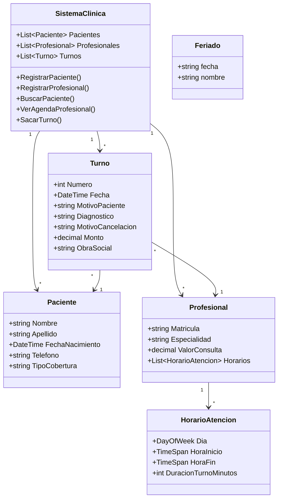

<div align="center">


<a href="https://git.io/typing-svg">
  
</a>

<br/>


</div>

---

## 📋 Descripción

**GestionTurnos** es una aplicación de consola desarrollada en **C#** que simula el sistema de turnos de una clínica o consultorio médico. Permite registrar pacientes y profesionales, definir los horarios de atención de cada profesional y asignar turnos validando que el horario esté libre, que el profesional atienda ese día y que la fecha **no sea feriado**.

El proyecto está diseñado con **programación orientada a objetos** a partir de un diagrama UML, aplicando clases, relaciones, encapsulamiento y manejo de excepciones.

---

## ✨ Funcionalidades

| | Funcionalidad | Descripción |
|---|---|---|
| 🧑‍⚕️ | **Registro de pacientes** | Nombre, apellido, fecha de nacimiento, teléfono y tipo de cobertura, con validación de cada dato ingresado |
| 👨‍⚕️ | **Registro de profesionales** | Matrícula, especialidad, valor de consulta y horarios de atención |
| 🔎 | **Búsqueda de pacientes** | Por nombre y apellido, con su historial de turnos |
| 📅 | **Sacar turno** | Asigna un turno y genera un comprobante con el costo estimado según la cobertura |
| 🗓️ | **Agenda del profesional** | Muestra los turnos de un profesional en un día determinado |
| 🇦🇷 | **Control de feriados** | Consulta una API de feriados de Argentina para impedir turnos en días no laborables |
| 💰 | **Cálculo de costos** | El monto de la consulta varía según el paciente sea Particular u Obra social |

---

## ✅ Validaciones al sacar un turno

```text
 ✔ El paciente existe
 ✔ El profesional existe
 ✔ La fecha no es anterior a la actual
 ✔ El día no es feriado (API de feriados de Argentina)
 ✔ El profesional atiende ese día y a esa hora
 ✔ El horario está libre (sin dos turnos a la misma hora)
```

---

## 🧱 Diagrama de clases



> La lista de turnos se centraliza en `SistemaClinica`, de modo que cada turno existe **una sola vez** y se filtra con LINQ según el paciente o el profesional.

---

## 🛠️ Tecnologías

- **C#** y **.NET**
- **LINQ** para filtrar y consultar colecciones
- **System.Text.Json** para leer la respuesta de la API de feriados
- **HttpClient** y **async/await** para las consultas web
- **[ArgentinaDatos API](https://argentinadatos.com/)** para los feriados nacionales

---

## 🚀 Cómo ejecutarlo

1. Cloná el repositorio:

   ```bash
   git clone https://github.com/TU_USUARIO/GestionTurnos.git
   ```

2. Abrí la solución `GestionTurnos.sln` con **Visual Studio**.
3. Presioná **F5** para compilar y ejecutar.

> Para el control de feriados se necesita conexión a internet. Si la consulta falla, el programa informa el error y no se cierra.

---

## 🗺️ Estado del proyecto

- [x] Registro y listado de pacientes
- [x] Registro y listado de profesionales
- [x] Horarios de atención por profesional
- [x] Control de feriados con API
- [x] Comprobante de turno con costo según cobertura
- [ ] Validación completa de horarios y duración de turnos
- [ ] Persistencia de turnos en archivo JSON
- [ ] Cancelación de turnos con motivo
- [ ] Carga de diagnóstico al atender
- [ ] Manejo de excepciones en todas las operaciones

---

## 👤 Autor

Proyecto desarrollado por **TU NOMBRE** como parte de la tecnicatura.

[](https://github.com/TU_USUARIO)

<div align="center">


</div>
